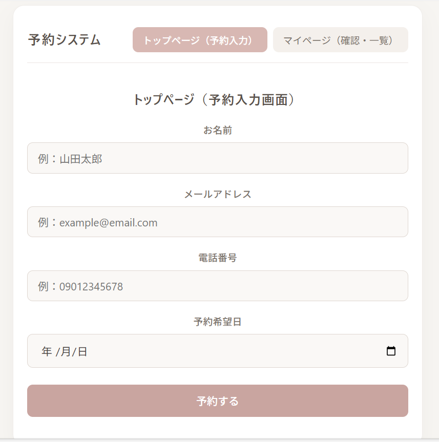
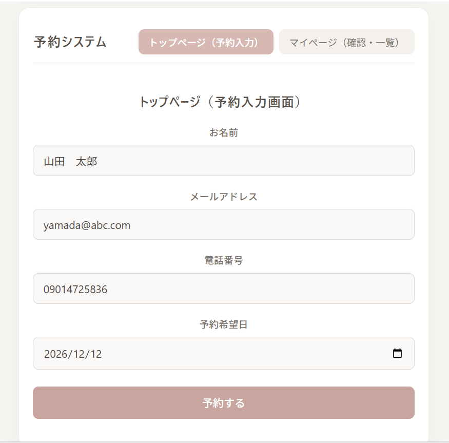
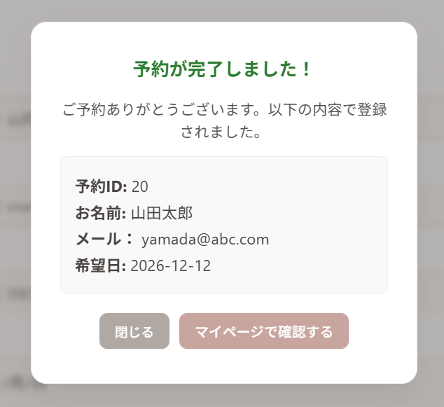
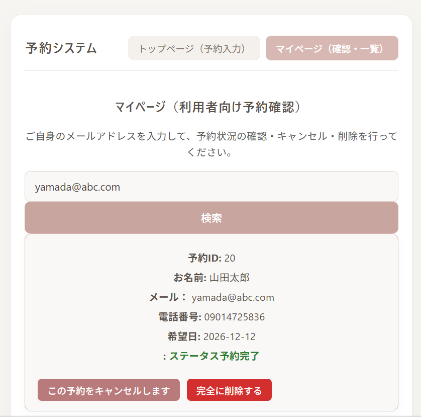
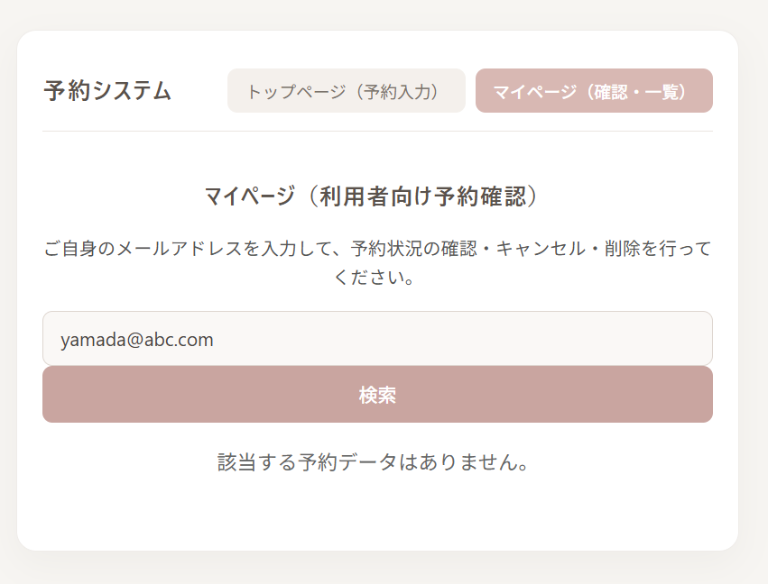
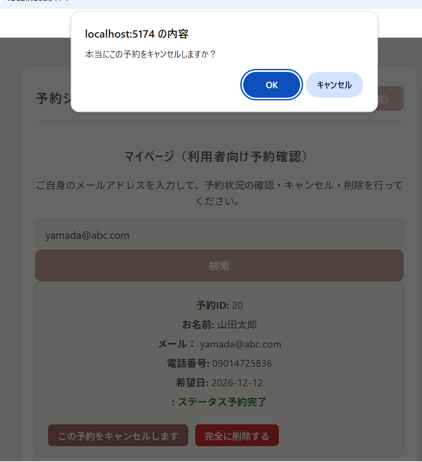
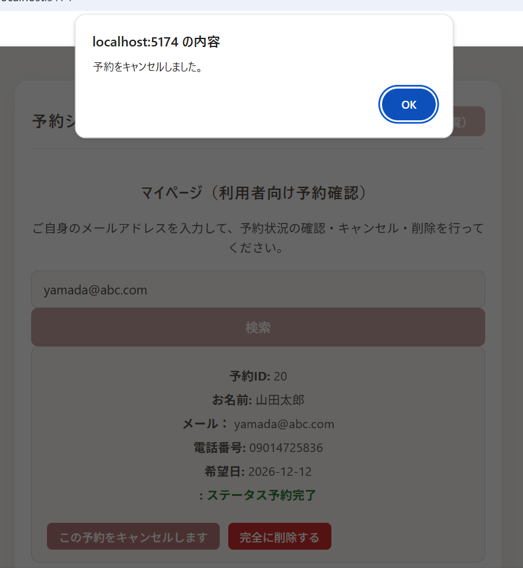
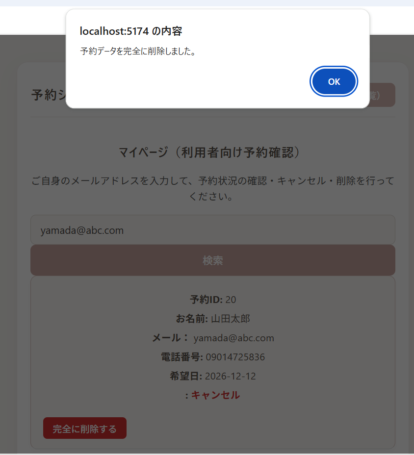
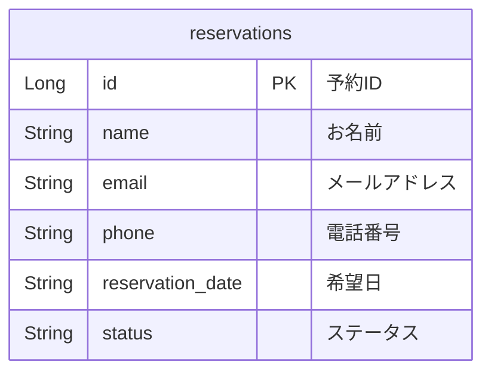

# 予約管理システム

## アプリケーションの概要

ユーザーが簡単に自分の予約を登録・確認・キャンセル・削除できる、Webベースの予約管理システムです。
フロントエンドにReact、バックエンドにSpring Bootを採用し、スムーズな非同期通信（API連携）を実現しています。

## 開発した背景や理由

店舗や施設などの予約管理において、ユーザーが手軽に自身の予約状況を確認・管理でき、不要になった予約は確実にキャンセルや削除を行える仕組みが必要だと考え、本システムを開発しました。
開発の過程では、フロントエンド（React）とバックエンド（Spring Boot・データベース）の間で正しくデータを送受信し、削除機能まで安全に連携させる部分に注力しました。

## アプリケーションのデモ

主要な画面のスクリーンショットと機能の紹介です。

### トップ画面（予約入力）

- 新しい予約の登録（お名前、メールアドレス、日時など）を行える画面です。
  
  

### 予約完了画面（ポップアップ）

- 新しい予約の完了を知らせる画面です。
  

### マイページ（予約確認・キャンセル・削除）

- 登録したメールアドレスを入力して検索し、ご自身の予約一覧を確認できる画面です。
  
  

- 予約のキャンセルや、完全にデータを削除する（物理削除）機能に対応しています。
  
  
  

## 使用技術（技術スタック）

| カテゴリ       | 技術スタック                       |
| :------------- | :--------------------------------- |
| フロントエンド | JavaScript, React, Vite            |
| バックエンド   | Java, Spring Boot, Spring Data JPA |
| データベース   | MySQL                              |
| その他         | Git, GitHub                        |

## ER図（データベース設計）



## ローカル環境での起動方法

評価者がご自身のPCで起動・動作確認を行う際の手順です。

### 必要環境

- Java 21
- Node.js
- MySQL
- Git

### インストール・手順

```bash
# 1. リポジトリをクローン
git clone https://github.com/IkuyoYamaguchi/reservation-app.git
cd reservation-app

# 2. データベースを作成 (MySQL)
# MySQLにログイン後、 `CREATE DATABASE reservation_db;` を実行してください。
# 設定ファイル (demo/src/main/resources/application.properties) のパスワード等も適宜変更してください。

# 3. バックエンド (Spring Boot) を起動
cd demo
.\gradlew.bat bootRun
# http://localhost:8080 で起動します

cd reservation-frontend
npm install
npm run dev
```
